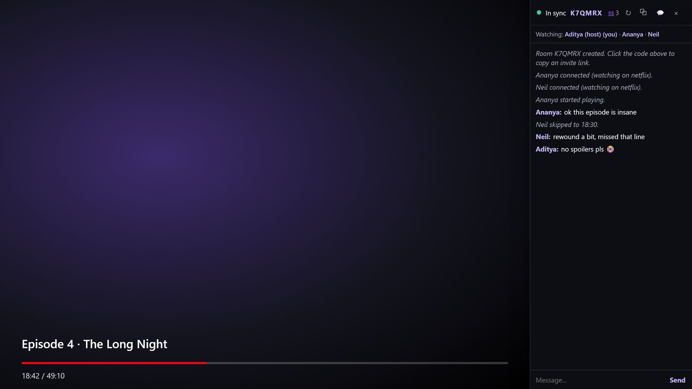
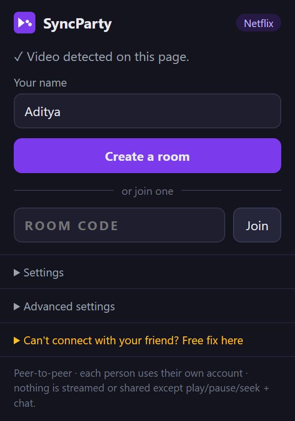
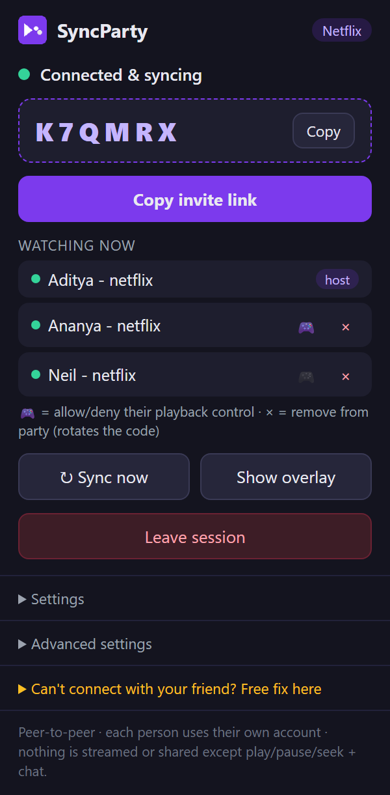
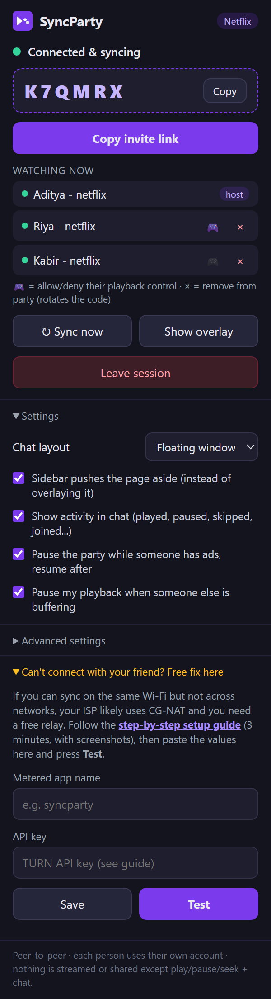
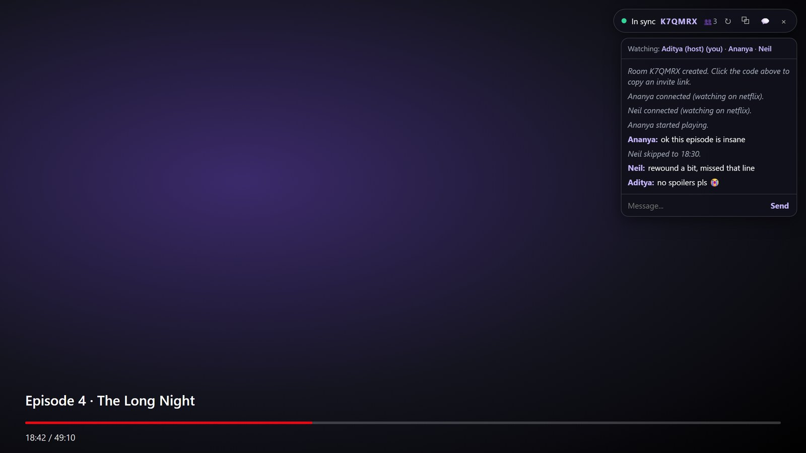

<p align="center">
  
</p>

<h1 align="center">SyncParty</h1>

<p align="center">
  Watch Netflix, Prime Video, JioHotstar, YouTube and pretty much any site with a video player together with friends, in sync.<br>
  No servers, no accounts, no stream sharing. Just a browser extension.
</p>

<p align="center">
  
  
  
  
</p>

<p align="center">
  
</p>

## Why I built this

My girlfriend and I live in different cities and wanted to watch shows together. Teleparty works, but it doesn't cover every site we use, and the first version of this project (Hotstar only) depended on a server on Render that took ages to wake up. So I rebuilt it from scratch with one rule: nothing to host, nothing to pay for.

Each person watches on their own account. SyncParty never touches the video stream, DRM, cookies or logins. The only thing it sends between browsers is "play", "pause", "seek to 32:18", a timestamp, and your chat messages.

## Features

- **Works on most sites.** Netflix, Prime Video, JioHotstar / JioCinema and YouTube have dedicated handling. Anything else with an HTML5 `<video>` falls back to a generic adapter, including players embedded in cross-origin iframes.
- **Rooms for any number of people.** Share a 6-letter code, or an invite link that opens the same page and joins automatically.
- **Play, pause and seek sync both ways.** Drift is corrected quietly in the background (small differences are fixed by nudging playback speed, big ones by seeking).
- **Episode changes follow along.** If anyone moves to the next episode, or backs out and starts something else, everyone else's tab loads it too.
- **Ads and buffering are handled.** When one person hits an ad or starts buffering, everyone else pauses and resumes together afterwards. Both behaviours can be switched off.
- **Chat with an activity feed.** "Ananya paused", "Neil skipped to 18:30", joins and leaves. The chat can float or dock as a sidebar that pushes the page aside, also in fullscreen.
- **Host controls.** Host-only mode, per-person control permissions, and kick. Kicking rotates the room code so the removed person can't get back in with the old one.
- **Sync now button** for when something looks off.
- **Free relay support** for networks where direct connections fail (common in India with CG-NAT ISPs), with a step-by-step setup guide built in.

## Screenshots

| Start a room | In a party | Settings |
|:---:|:---:|:---:|
|  |  |  |

<p align="center">
  
  <br><sub>Floating chat. Click the room code to copy an invite link.</sub>
</p>

## Install

### Chrome Web Store

Coming soon.

### Manual install (Windows, Chrome or Edge)

1. Download `SyncParty.zip` from the [latest release](../../releases/latest) and unzip it.
2. Right-click `installer\Install-SyncParty.ps1` and choose **Run with PowerShell**. It copies the extension to a permanent folder, opens the extensions page and puts the folder path on your clipboard.
3. Turn on **Developer mode**, click **Load unpacked**, paste the path and pick the folder.

Or do it by hand: open `chrome://extensions`, enable Developer mode, click **Load unpacked** and select the `extension` folder from this repo.

> If the popup says to open a video page while you're already on one, refresh the tab once. Tabs that were open before the extension was installed don't have it loaded yet.

## How to use

1. Both of you install SyncParty and log in to the streaming site with your own accounts.
2. The host opens a video, clicks the SyncParty icon and hits **Create a room**.
3. Send your friend the invite link (or just the code).
4. Press play. That's it.

### "It works on the same Wi-Fi but not between our homes"

That's your ISP's NAT getting in the way of a direct connection. The fix is a free TURN relay from [Metered](https://www.metered.ca/tools/openrelay/):

1. Open the SyncParty popup and expand **Can't connect with your friend? Free fix here**.
2. Follow the linked guide (five screenshots, about three minutes).
3. Paste the app name and API key, press **Test**, and wait for "Working!".

Only one person in the room needs to do this. The free 500 MB plan is more than enough; SyncParty sends a few megabytes over a hundred hours of watching.

## How it works

```
 popup ──► content script (top frame) ─────────────────────────────┐
              │                                                    │
      ┌───────┴────────┐             ┌──────────────┐     ┌────────┴────────┐
      │ player adapter │◄───────────►│  sync engine │◄───►│ hidden iframe   │
      └───────┬────────┘             └──────────────┘     │ running PeerJS  │
              │                                           └────────┬────────┘
   site API (Netflix, YouTube)                                     │ WebRTC data channel
   or the <video> element itself                                   ▼
   (+ agents inside child iframes)                          other browsers
```

**Talking to the player.** Every site gets an adapter with the same small interface (`play`, `pause`, `seek`, `getCurrentTime`, and a callback for state changes). Netflix and YouTube expose internal player APIs, so commands go through those; Netflix in particular doesn't like having `video.currentTime` set directly. Everything else talks to the `<video>` element. Events always come from the element itself because the standard media events keep working through DRM and site redesigns. The generic adapter watches the DOM, scores every video it finds by size, duration and whether it's actually playing, and re-evaluates when ads or previews show up. There are no hardcoded CSS selectors.

**Connecting people.** Signalling uses the free public PeerJS server. Once two browsers find each other, all traffic goes directly between them over a WebRTC data channel. The connection lives in a hidden extension iframe rather than the content script (so the site's CSP can't block it) or the service worker (which Chrome kills after 30 seconds of inactivity). The host is the hub: guests connect to the host, and the host relays messages to everyone else.

**Keeping time.** Messages carry the sender's timestamp. When peers connect they exchange a few pings to estimate their clock offset, so a "play at 12:04" message can be adjusted for however long it took to arrive. Every four seconds the host sends a heartbeat with its position, and guests correct drift: under 0.35 s is ignored, up to 2.5 s is fixed by speeding up or slowing down by 8%, and anything larger is a seek. Commands applied from the network are tagged so the resulting local events don't bounce back.

**Invite links.** An invite link is the current page URL plus `#syncparty=CODE`. A script that runs before the page loads saves the code to session storage, so it survives redirects such as JioHotstar's profile picker.

**Sidebar in fullscreen.** Chrome won't let page CSS resize an element that's in fullscreen, but it does allow it for the page root. While the sidebar is docked, SyncParty redirects the site's fullscreen request to `<html>` and reports the original element back to the site, so the player reflows next to the sidebar instead of under it.

## Project layout

```
extension/
├── manifest.json
├── default_settings.json      default values for every setting
├── turn-config.js             optional: bake a TURN key into your own build
├── content/
│   ├── adapters/              generic, netflix, youtube, prime, hotstar, composite
│   ├── sync-engine.js         messages, clock sync, drift correction
│   ├── orchestrator.js        session lifecycle, popup commands, ad detection
│   ├── overlay.js             chat UI and sidebar
│   ├── transport.js           bridge to the peer iframe
│   ├── frame-agent.js         video discovery inside child iframes
│   ├── hash-catcher.js        saves invite codes before redirects
│   └── fs-hijack.js           fullscreen redirect for the sidebar
├── page/page-agent.js         Netflix / YouTube player API bridge
├── peer/                      hidden iframe that owns the PeerJS connection
├── popup/                     toolbar popup
├── help/                      relay setup guide
└── vendor/peerjs.min.js       PeerJS 1.5.5
installer/Install-SyncParty.ps1
```

## Configuration

- **Defaults.** `extension/default_settings.json` holds the starting value of every user setting (chat layout, sidebar push, activity messages, ad pause, buffer pause, control mode). Users' own choices are saved in the browser and override these.
- **Shared relay key.** If you distribute your own build and want everyone to use your Metered account, set `ASK_USER_API: false` in `extension/turn-config.js` and fill in the app name and key. The relay section disappears from the popup. Anyone with the files can read the key, so only do this for builds you share privately.

## Privacy

SyncParty has no backend and collects nothing. What leaves your browser, and only to the people in your room: playback commands with timestamps, the URL of the page you're watching (for invite links and episode following), your display name and your chat messages. The PeerJS server only sees the random IDs used to introduce browsers to each other. If you set up a TURN relay, Metered can see that encrypted traffic passes through it, not what it contains.

## Known limitations

- Everyone needs their own subscription to whatever you're watching.
- Following an episode change reloads the tab, so there's a short reconnect.
- The ad detection on sites other than YouTube is a heuristic (a long video suddenly becoming a short one). It's good but not perfect.
- Playback automation may sit in a grey area of some platforms' terms, same as every other watch-party extension.

## License

MIT. See [LICENSE](LICENSE).
